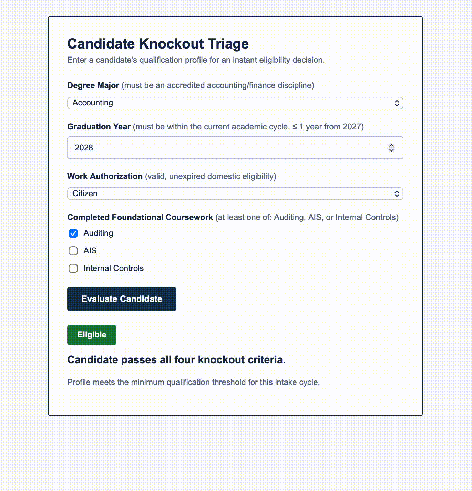
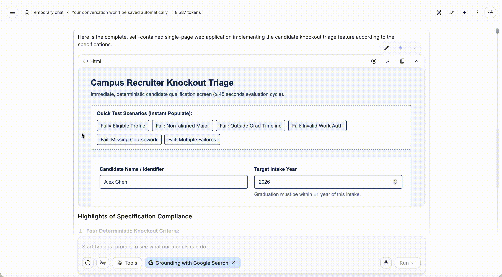

# HW6: Two Builders, One Specification

## Feature

**Team repository:** https://github.com/Kcornett533/mgt3745-team-beta
**Spec provenance:** copied from commit `d3c4267fabcf4433c96778256640c3a07a5fd97b` on <2026-10-19>

**Feature:** Feature F-01: Accounting Compliance Knockout Gate (Must-be)

- **Ubiquitous:** The system shall evaluate candidate eligibility against explicit, deterministic criteria:
  1. **Degree Alignment:** Major must be strictly within accredited accounting/finance disciplines (`Accounting`, `Finance`, `Accounting Information Systems`, or `Internal Audit`).
  2. **Graduation Timeline:** Graduation year must be within the current academic cycle ($\le 1$ year from target intake).
  3. **Work Authorization:** Must possess valid, unexpired domestic employment eligibility (`Citizen`, `Permanent Resident`, `F-1 OPT`, or verified work visa).
  4. **Coursework Prerequisite:** Completion of at least one foundational governance or assurance course (Auditing, AIS, or Internal Controls).
- **Event-driven:** When a candidate submits their qualification profile, the system shall evaluate the credentials against the four criteria and assign an immediate, strictly binary status badge (`Eligible` or `Ineligible` with no indeterminate or conditional states).
- **State-driven:** While displaying evaluation results, the system shall render `Eligible` in success green (`#1b8036`) and `Ineligible` in error red (`#922020`) per `STYLE.md`.
- **Unwanted-behavior (IF):** If any of the four deterministic criteria fail to be satisfied, then the system shall flag the profile as `Ineligible` and specify which exact requirement was unmet without throwing unhandled execution exceptions.

## See It Work

| bolt.new | AI Studio |
|---|---|
|  |  |

## Status

Both builders satisfied 4 of 4 EARS rows (Ubiquitous, Event-driven, State-driven, and Unwanted-behavior IF); our team recommends Google AI Studio (Gemini 3.8 Flash) for Phase 2 integration due to strict zero-dependency vanilla compliance and single-file portability.

## How to Run the Evals

```bash
npm test
```

The test runner executes `evals/shared.test.js` using Node's built-in `node:test` engine against both `evals/impl/bolt.js` and `evals/impl/aistudio.js`. It checks compliant candidate qualification, non-compliant knockout gating with specific unmet reasons, and output determinism across repeated identical evaluations. Expected output: 6 passing tests, 0 failures.

## Links

- [EVALS.md](EVALS.md): Prediction Stake and error log
- [COMPARISON.md](COMPARISON.md): evidence, spec gaps, and recommendation
- [JUDGMENT.md](JUDGMENT.md): judgment eval and agreement rate
- [prompts/PROMPT.md](prompts/PROMPT.md): the exact input both builders received
- [builds/](builds/): bolt.zip and aistudio.zip
- [docs/DDR-001.md](docs/DDR-001.md) (bolt.new), [docs/DDR-002.md](docs/DDR-002.md) (AI Studio)
- Team pull request or issue: https://github.com/Kcornett533/mgt3745-team-beta/issues/15

## Hours

Total hours spent: 3 hours.

## AI Use

- bolt.new (Standard agent): generated initial multi-file WebContainer prototype ([DDR-001](docs/DDR-001.md)).
- Google AI Studio (Gemini 3.8 Flash): generated self-contained single-page component ([DDR-002](docs/DDR-002.md)).
